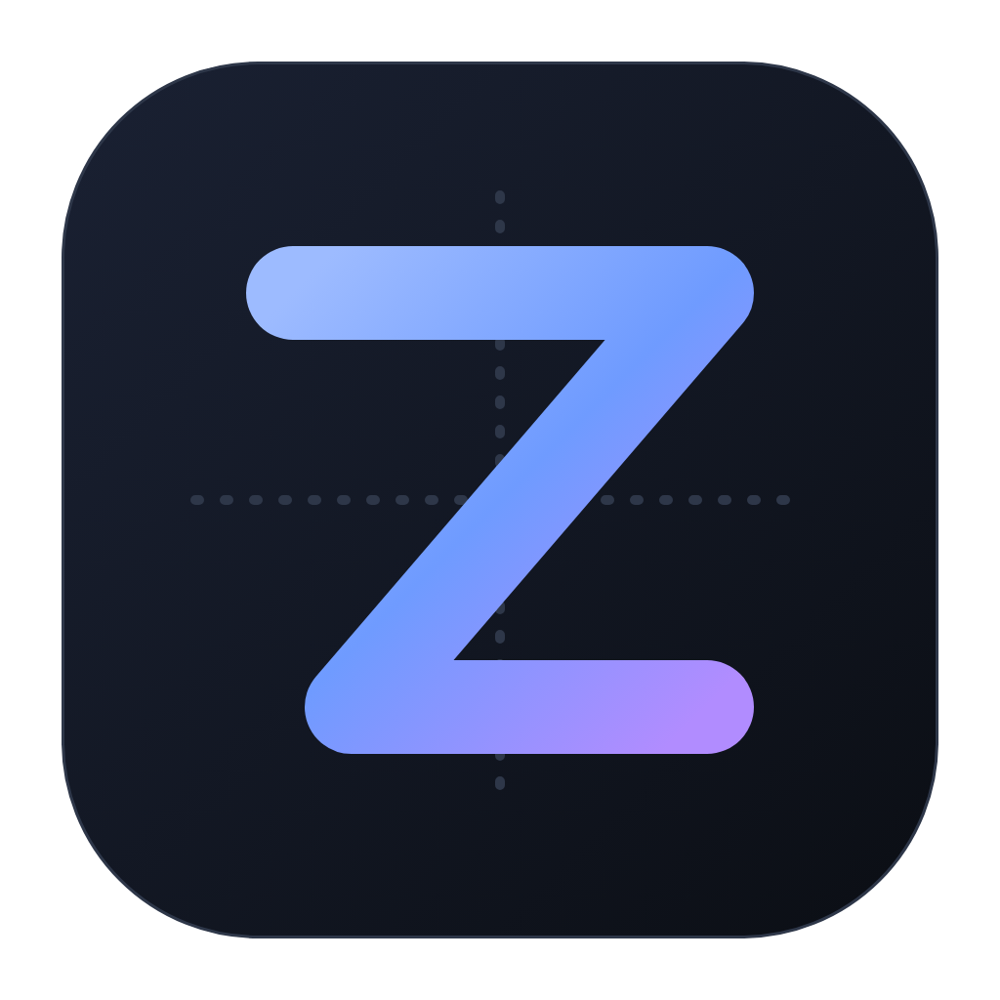

# Zortex

A portable terminal for **Windows and macOS** with parameterized snippets and a 2- or 4-way split view.



## Features

- **Snippets**: Save the commands you use often and run them in the target terminal **with a single click**.
- **Parameters**: Write `{{name}}` in a command; when you run it, a dialog asks for the values.
  - Default value: `{{port:22}}`
  - A parameter that appears in several places is asked only once.
  - The last values you entered are pre-filled the next time.
  - The dialog shows a live preview of the final command.
- **Insert parameter button**: Inserts `{{}}` in the editor and places the cursor right in the middle. If text is selected, it wraps the selection. Shortcut: `Ctrl/⌘+Shift+P`.
- **Categories**: Collapsible tree view with a snippet count per category, plus rename and delete.
- **Sorting**: Sort snippets by name (A→Z / Z→A), date added or last edited, or arrange them by **drag and drop** (also `Alt+↑/↓`). Dragging onto another category moves the snippet there.
- **Command and file completion** in the terminal:
  - Typing a command shows matching programs from `PATH`, shell built-ins and, in PowerShell, cmdlets and aliases.
  - Arguments show matching files and folders; after `cd`, only folders, with `.`, `..` and `~` at the top.
  - `↑/↓` select, `Tab` completes (a single match completes directly), `Esc` closes. If there is nothing to suggest, `Tab` goes to the shell's own completion.
  - `Ctrl+Space` toggles a detailed view (like `ls -al`: permissions, size, date, hidden files).
  - Settings: show while typing, only on `Tab` / `Ctrl+Space`, or off.
- **Subcommands, options and values for ~90 popular tools**, with descriptions:
  - `git`, `gh`, `npm`, `yarn`, `pnpm`, `docker`, `kubectl`, `helm`, `terraform`, `ssh`, `curl`, `pip`, `cargo`, `go`, `dotnet`, `brew` and more, from Fig's open-source [completion specs](https://github.com/withfig/autocomplete). On macOS (and in Git Bash) Unix tools such as `ls`, `grep`, `tar`, `chmod` and `ps` are covered too.
  - Windows tools with Zortex's own specs: `winget`, `choco`, `scoop`, `wsl`, `ipconfig`, `ping`, `netstat`, `tasklist`, `taskkill`, `robocopy`, `shutdown`, `sfc`, `where`.
  - Dynamic values: git branches, npm/yarn/pnpm scripts from the nearest `package.json`, WSL distributions, and so on. These are read-only queries that Zortex runs in the background (for example `git branch`). They run without a shell and time out after 5 seconds.
  - In PowerShell, names that are cmdlet aliases (`ls`, `curl`…) keep PowerShell's meaning, and the Unix specs are not applied to them.
- **Shell integration**: A small script reports the current folder and prompt position to Zortex on every prompt (PowerShell, cmd, zsh, bash, Git Bash, fish). Your own profile files load as usual and the prompt looks the same. It can be turned off in Settings.
- **Search**:
  - Searches snippet names, commands, descriptions and category names.
  - Ignores case and Turkish diacritics (typing `baglanti` finds `bağlantı`).
  - Highlights matching words.
  - `Enter` runs the first result; `↓` moves through the list.
- **Split terminal**: Single, two-way (side by side / stacked) and four-way layouts.
  - Drag the dividers to resize; double-click to make panes equal.
  - Panes hidden by switching to a smaller layout are not closed; their sessions are kept.
- **Target (focused) terminal**:
  - Snippets run in the target terminal.
  - The target pane is marked with a blue border and a **Hedef** (Target) badge.
  - The bottom of the sidebar also shows “Hedef: Terminal N”.
  - To change the target, click a pane, use the ⌖ button, or press `Ctrl+Shift+1…4` / `⌘1…4`.
- **Portable**: No installation required.
  - On Windows it's a single `.exe`; data is kept in a `Zortex Data` folder next to the exe, so you can carry the app on a USB stick.
  - On macOS you can put the `.app` anywhere and run it.
- **Import/export**: Share snippets as a JSON file. Imports are merged with existing snippets; duplicates are not added again.
- **Shell selection**:
  - Windows: PowerShell 7, Windows PowerShell, cmd, Git Bash, WSL
  - macOS: zsh, bash, fish… (whatever is listed in `/etc/shells`)

> The user interface is currently in Turkish.

## Usage

| Action | Windows | macOS |
|---|---|---|
| Search snippets | `Ctrl+Shift+F` | `⌘F` |
| New snippet | `Ctrl+Shift+N` | `⌘N` |
| Toggle sidebar | `Ctrl+Shift+B` | `⌘B` |
| Target terminal | `Ctrl+Shift+1…4` | `⌘1…4` |
| Copy | `Ctrl+C` while text is selected, or `Ctrl+Shift+C` | `⌘C` |
| Paste | `Ctrl+V` / `Ctrl+Shift+V` | `⌘V` |
| Copy / paste | Right-click (copies if there is a selection, otherwise pastes) | Right-click |
| Clear screen | Eraser button in the pane header | `⌘K` |
| Open link | `Ctrl` + click | `⌘` + click |

On Windows, app shortcuts start with `Ctrl+Shift` because keys like `Ctrl+F` and `Ctrl+B` on their own belong to the shell.

### Snippet syntax

```text
ssh {{user}}@{{host}} -p {{port:22}}
docker exec -it {{container}} {{command:sh}}
git commit -am "{{message}}"
```

Values are inserted into the command as-is. Wrap values that may contain spaces in quotes in the template (`"{{path}}"`). Zortex does not add any escaping, because quoting rules differ between PowerShell, cmd and zsh.

If you uncheck **Hemen çalıştır** (Run immediately) when creating a snippet, the command is typed into the terminal but Enter is not pressed, so you can review it before running.

## Download and run

### Windows

Put `Zortex-<version>-portable.exe` in any folder and double-click it.

Because the app is unsigned, SmartScreen may show a warning on first launch. Click **More info → Run anyway** to open it. Windows 10 and 11 are supported.

### macOS

Unzip `Zortex-<version>-mac-arm64.zip` (Apple Silicon) or `-mac-x64.zip` (Intel), then move `Zortex.app` wherever you like.

Because the app is not signed with an Apple Developer certificate, Gatekeeper blocks it on first launch. There are two ways around this:

- Right-click `Zortex.app` → **Open** → **Open**, or
- In a terminal: `xattr -dr com.apple.quarantine /Applications/Zortex.app`

On macOS, data is stored in `~/Library/Application Support/Zortex` by default. For portable use, create a folder named `Zortex Data` next to `Zortex.app`, and Zortex will write its data there.

## Development

Requirements: Node.js 20+ (24 recommended). No compiler is needed; `node-pty` ships prebuilt binaries for both platforms.

```bash
npm install
npm run dev          # development mode (hot reload)
npm run typecheck    # TypeScript check
npm test             # unit tests (vitest)
npm run test:e2e     # builds and runs end-to-end tests against the real app with Playwright
npm run icon         # regenerates build/icon.png and resources/icon.png from scripts/make-icon.cjs
npm run dist:win     # dist/Zortex-<version>-portable.exe
npm run dist:mac     # dist/Zortex-<version>-mac-{arm64,x64}.{zip,dmg}  (macOS only)
```

The macOS package can only be built on macOS. The `.github/workflows/build.yml` workflow:

- On every push, runs the tests on both platforms, builds the Windows and macOS packages, and uploads them as downloadable *artifacts*.
- When a `v*` tag is pushed (`git tag v0.1.0 && git push --tags`), attaches the packages to a GitHub Release.

### Structure

```text
src/
  main/       Electron main process: window, PTY sessions (node-pty), shell detection and integration, completion data, storage, IPC
  preload/    Narrow, secure API exposed to the renderer (contextIsolation + sandbox)
  shared/     Platform-independent logic: parameter parsing, search, sorting, command-line parsing, data validation
  renderer/   React UI: sidebar, terminal grid (xterm.js), dialogs
resources/    Runtime assets (window icon)
tests/
  unit/       Tests for parameter, search and data logic
  e2e/        End-to-end tests against the real app
```

### Technical decisions

- **Electron + xterm.js + node-pty**:
  - xterm.js is the terminal renderer VS Code uses too.
  - node-pty hides the differences between Windows ConPTY and the macOS PTY.
  - Tauri would produce a smaller package, but it requires Rust and the MSVC build tools. This stack needs no extra tooling and behaves the same on both platforms.
- **Security**:
  - The renderer runs with `contextIsolation` and `sandbox` enabled and no Node access.
  - IPC calls are validated by sender and by type.
  - External links are opened only for http/https/mailto, and the page cannot navigate to another address.
- **Data safety**:
  - Data is first written to a temporary file and then moved into place.
  - A corrupted data file is never deleted; it is backed up as `data.corrupt-*.json`.
- **Completion and shell integration**:
  - On every prompt, the shell writes invisible OSC sequences: `OSC 6973;cwd`, `OSC 6973;path` and `OSC 6973;prompt` (Zortex-specific), plus the standard `OSC 133;A/B/C/D`.
  - How the integration is loaded: zsh via `ZDOTDIR`, bash via `--init-file`, fish via `--init-command`, PowerShell via `-EncodedCommand` (so execution policy does not block it), and cmd via `PROMPT`.
  - ConPTY on Windows can deliver OSC sequences ahead of the text that precedes them, so the input start is found from the prompt text (PowerShell, cmd) rather than from where the sequence arrived. Unix shells mark it with `133;B`.
  - Without integration (e.g. WSL), only default PowerShell/cmd prompts and `cd` are recognised.
- **Completion specs**:
  - The Fig specs (`@withfig/autocomplete`, MIT license) are bundled as separate chunks and loaded only when their command is typed. aws and gcloud are left out because together they would add about 50 MB.
  - Generators run through a small runner in the main process with no shell and a time limit. On Windows, `.cmd` wrappers never get arguments containing `cmd.exe` metacharacters, so a half-typed word can never be executed.
  - Fig's generators assume Unix tools. On Windows, `ls`, `cat` and the "find the nearest `package.json`" bash snippets are emulated in-process, and other `bash -c` scripts use Git Bash when it is installed.

## Third-party notices

Completion specs from [withfig/autocomplete](https://github.com/withfig/autocomplete) are used under the MIT license, Copyright (c) 2021 Hercules Labs Inc. (Fig).
